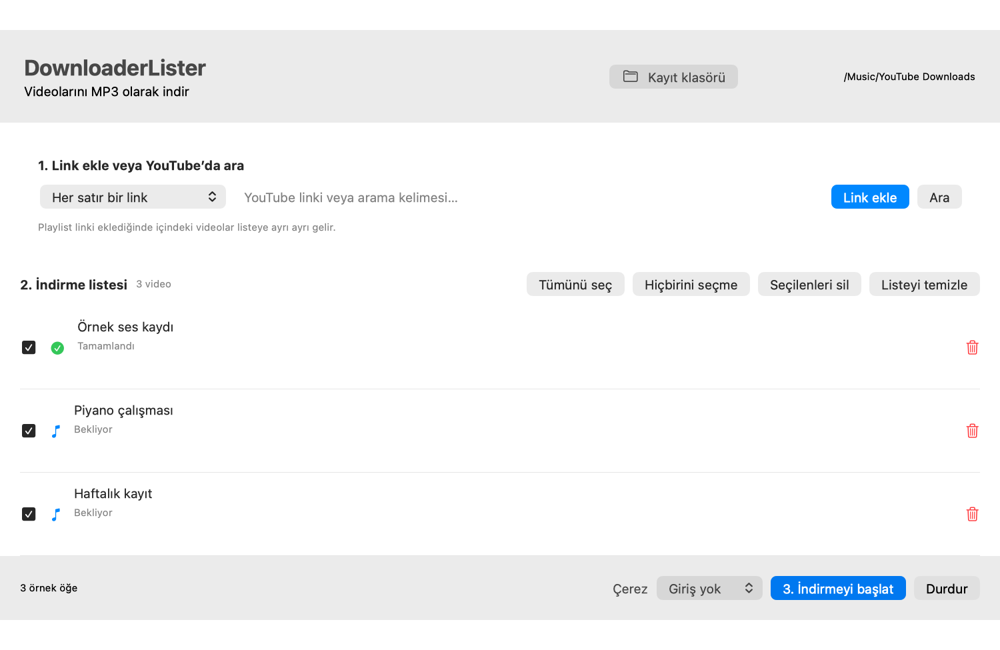

# DownloaderLister

Apple Silicon macOS için SwiftUI tabanlı YouTube → MP3 indirici.



## Gereksinimler

macOS 14 veya sonrası, Xcode 16 veya Swift 6 ve Homebrew gerekir.

Homebrew ile araçları kur:

```bash
brew install yt-dlp ffmpeg
```

## Çalıştırma

```bash
swift run
```

Ya da `Package.swift` dosyasını Xcode ile açıp **Run** düğmesine bas.

## Kullanım

- Satır satır link veya yapıştırılmış metinden YouTube linklerini ayıklama modunu seç.
- Playlist linki eklenince videolar otomatik açılır ve tümü seçili gelir.
- Arama kutusuna terim yazıp **Ara** düğmesine basarak `yt-dlp` üzerinden arama yap.
- Özel playlistler için çerez kaynağını Chrome, Safari veya Firefox olarak seç.
- Hedef klasörü, çakışma davranışını ve indirme kuyruğunu üst çubuktan yönet.
- Aynı anda en fazla iki indirme çalışır.

Uygulama, YouTube oturum çerezlerini parola olarak saklamaz; seçilen tarayıcı profilinden `yt-dlp` aracına aktarır. İndirme hakkına sahip olduğun içerikleri kullan.

Örnek toplu kullanım: iki bağlantıyı ayrı satırlara yapıştır, **Link ekle** düğmesine bas, listede istediğin kayıtları seç ve **İndirmeyi başlat** düğmesini kullan.
